# Датчики ленточного стационарного конвейера (КЛС) НПО «Аконит»

> **Важное уточнение по источникам.** АО «НПО «Аконит» (г. Вологда) — производитель самих конвейеров (КЛС-500…КЛС-2000), а не датчиков. В своих проектах компания заявляет комплексную автоматизацию «от полевого уровня до SCADA» и систему **«Умный конвейер»** — оснащение конвейера датчиками контроля состояния оборудования: целостность ленты, контроль продольного порыва, контроль скорости движения ленты, состояние комплектующих в «узких» местах (загрузка, разгрузка, узлы пересыпа), онлайн-диагностика 24/7. Конкретные модели датчиков на сайте «Аконита» публично не перечислены — поэтому ниже дан **полный отраслевой перечень датчиков, которыми комплектуется КЛС**, с типовыми применяемыми в РФ моделями (НПК ТЕКО / ОП ТЕКО, НЗКА, INNOLEVEL и др.), которые ставятся на конвейеры «Аконита» и аналогичные.

Источники: сайт НПО «Аконит» ([продукт КЛС](https://www.npoakonit.ru/product/konveyer-lentochnyy-stacionarnyy), [презентация «Умный конвейер»](https://protoplan.pro/ru/expo/minex-russia/attendees/invite/akonit)), каталоги конвейерной автоматики [ОП ТЕКО](https://www.op-teko.ru/products/normal/dksl/), [НЗКА](https://www.nzka.ru/products/rn/dksl/), [ТЕКО](https://teko-com.ru/product/dksl-75000.html), [Русавтоматизация](https://rusautomation.ru/articles/datchiki_dlya_bezopasnoy_raboty_konveyerov_14794/).

---

## Сводная таблица

| № | Датчик | Что контролирует | Где стоит |
|---|--------|------------------|-----------|
| 1 | ДКСЛ — контроль схода ленты | боковое смещение ленты | по обеим сторонам става, каждые 30–50 м |
| 2 | ДЭК / тросовый выключатель | аварийный останов человеком | вдоль всей трассы |
| 3 | УКПР/ДКПР — продольный разрыв (просыпь) | продольный порыв ленты | под лентой в зоне загрузки |
| 4 | ДКПГ — положение груза натяжной станции | поперечный разрыв ленты, обрыв груза | грузовая натяжная станция |
| 5 | ДКС/ДКМС/УКС — скорость ленты | пробуксовка, обрыв, недоскорость | вал натяжного/отклоняющего барабана |
| 6 | ДПЛ / IL-BWS — провисание ленты | перегруз, ослабление натяжения | после узла загрузки |
| 7 | ДКПЛ — повреждения и износ ленты | порывы, отслоения, износ обкладки | над/под лентой, поперёк полотна |
| 8 | Датчик перегруза / препятствия (IL-BHS) | негабарит, завал на ленте | над лентой после загрузки |
| 9 | Датчики подпора / заштыбовки | завал течки, узла пересыпа | течки, бункеры, пересыпы |
| 10 | Датчики температуры подшипников | перегрев подшипников барабанов/редуктора | приводной и натяжной барабаны |
| 11 | Датчик проскальзывания/целостности очистителя, износа скребка | состояние очистителя | зона разгрузки |
| 12 | ДОГ — контроль ограждений | открытие ограждений/люков | ограждения привода |
| 13 | Металлодетектор | металл в потоке груза | над лентой перед дробилкой |
| 14 | Датчики уровня в бункере (СУ) | наличие/переполнение материала | бункеры, течки |
| 15 | Датчик обратного хода / контроля тормоза | самопроизвольный откат наклонного конвейера | приводной барабан |
| 16 | Датчик натяжения (тензодатчик) | усилие натяжения ленты | натяжное устройство |
| 17 | Весы конвейерные (тензо + датчик скорости) | производительность, т/ч | линейная секция става |

---

## 1. Датчик контроля схода ленты (ДКСЛ)

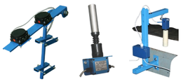

**За что отвечает.** Предотвращает боковой сход (уход) ленты с роликоопор — самую частую аварию конвейера, приводящую к разлохмачиванию кромки, задирам о металлоконструкции и просыпи груза.

**Как работает.** Ролико-рычажный механический датчик, питание не требуется. Устанавливается парами по обе стороны става с зазором 30–50 мм от кромки ленты. Ушедшая в сторону лента набегает на вертикальный ролик и отклоняет рычаг:
- отклонение **15°** → срабатывает первая пара контактов → предупредительный сигнал оператору / включение центрирующих роликоопор;
- отклонение **30°** → вторая пара контактов размыкает цепь безопасности → экстренный останов привода.

Контакты «сухие», НЗ/НО, можно включать последовательно в один шлейф; с адресным модулем (АМ) и устройством УКК определяется адрес сработавшего датчика.

**Типовые модели.** ДКСЛ-Н1(2)-03, ДКСЛ-Н3-33, ДКСЛ-В-01…03 (верхнее крепление), ДКСЛ-В-11…22 (двухпозиционные), ДКСЛ-750000, ДКСЛ-770007, ДКСЛ-7500/7502, взрывозащищённые ДКСЛ-…-Ex; импортные аналоги IL-BMS, SRT.
**Характерные параметры.** IP67, корпус Д16Т / полиацеталь, ролик полиацеталь, коммутация до 250 В / 1 А, 50 Вт; исполнения ВТ (−15…+105 °С), НТ (−45…+65 °С), 2НТ (−60…+50 °С) — последнее как раз под заявленный «Аконитом» диапазон до −60 °С.

---

## 2. Датчик экстренной остановки конвейера (ДЭК, тросовый выключатель)

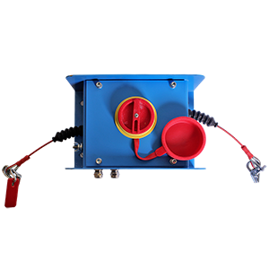

**За что отвечает.** Ручной аварийный останов конвейера с любой точки трассы — обязательное требование ТБ, так как конвейер обслуживается по всей длине.

**Как работает.** Вдоль става (обычно с одной стороны, на высоте ~1,2 м) натянут стальной трос, закреплённый на роликах-проушинах и заведённый в датчики через каждые 20–40 м. Рывок троса в любом месте (или его обрыв/ослабление) поворачивает рычаг датчика, механизм **защёлкивается с фиксацией** (самовозврата нет) и размыкает цепь безопасности — привод обесточивается. Возврат — только вручную кнопкой сброса на корпусе, что не даёт пустить конвейер, пока персонал не покинул зону. Датчики с двумя парами контактов дополнительно сигнализируют «трос ослаб».

**Типовые модели.** ДЭК-12/13М, ДЭК-2М/3М-21(22), посты аварийного останова ПА-1/ПА-2, взрывозащищённые ДЭК-…-Ex; импортные ER5018 и др. IP67, длина участка троса до 40–100 м на датчик.

---

## 3. Устройство/датчик контроля продольного разрыва ленты (УКПР, ДКПР) — «датчик просыпи»

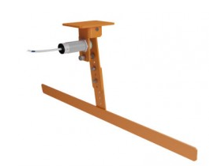

**За что отвечает.** Обнаружение **продольного порыва** ленты — самой дорогой аварии: острый кусок или застрявший предмет вспарывает полотно по ходу движения, и за секунды может быть уничтожено несколько сотен метров ленты.

**Как работает.** Под нижней (холостой) ветвью, сразу за узлом загрузки (главное место возникновения порывов), поперёк конвейера подвешена **воронка/лоток-приёмник просыпи** с подвижным элементом на шарнире. При продольном разрыве груз начинает сыпаться сквозь ленту в лоток; его вес отклоняет подвижный элемент, металлическая пластина выходит из зоны чувствительности **индуктивного или герконового датчика**, блок УКПР формирует аварийный сигнал и мгновенно останавливает привод.

Более продвинутый вариант того же контроля — **система с магнитными петлями (кордовыми маркерами), вулканизированными в ленту**: рамочные индуктивные приёмники вдоль трассы считывают петли, и при разрыве петли (или пропаже отклика) выдаётся авария. Это то, что в «Умном конвейере» «Аконита» названо «контроль целостности ленты / контроль продольного порыва».

**Типовые модели.** УКПР1-01, УКПР2, ДКПР1(2)-… + индуктивный/герконовый датчик.

---

## 4. Датчик положения груза натяжной станции (ДКПГ) — контроль поперечного разрыва

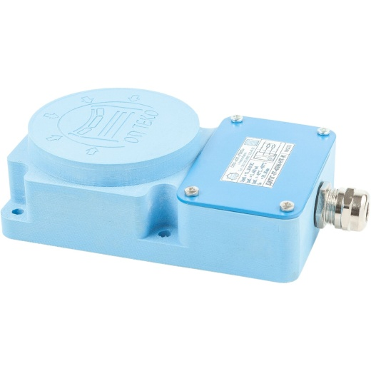

**За что отвечает.** Фиксирует две аварии: **поперечный разрыв ленты** (в т. ч. по стыку) и **обрыв груза грузовой натяжной станции**.

**Как работает.** Груз натяжной станции в нормальном режиме «висит» в определённом диапазоне высоты. Датчик (индуктивный, бесконтактный) ставится на направляющих натяжной станции так, чтобы металлическая рама грузовой тележки была в зоне чувствительности. Как только лента рвётся поперёк, натяжение исчезает и груз резко проваливается вниз (или, при обрыве самого груза, уходит вверх/падает) — рама покидает зону чувствительности датчика, формируется сигнал аварийного останова. Также он контролирует ход натяжного устройства (крайние положения — «вытяжка ленты исчерпана, требуется перестыковка»).

**Типовые модели.** ДКПГ-I7-К-…, ДКПГ-…-НТ; в схеме — с устройством контроля конвейера УКК.

---

## 5. Датчики контроля скорости ленты (ДКС, ДКМС, УКС, УКМС)

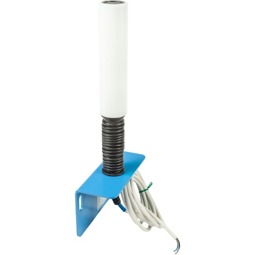

**За что отвечает.** Контроль фактической скорости полотна: **пробуксовка ленты по приводному барабану** (перегруз, ослабленное натяжение, обледенение), падение скорости ниже уставки, полная остановка при работающем двигателе (обрыв ленты, заклинивание), а также разгон/выбег при пуске и «обратный ход».

**Как работает.** На вал **неприводного** барабана (натяжного или отклоняющего — чтобы мерить скорость самой ленты, а не двигателя) насаживается диск с металлическими лепестками/магнитами, напротив — индуктивный или герконовый бесконтактный датчик. Он выдаёт импульсы, частота которых пропорциональна скорости ленты. Блок (УКС / УКМС / контроллер «Монитор КС-31Р») сравнивает частоту с уставкой:
- скорость ниже, например, 75–85 % номинала дольше заданной выдержки → авария «пробуксовка», останов;
- нет импульсов при включённом приводе → «лента стоит / обрыв»;
- при пуске даётся время разгона, чтобы не было ложных срабатываний.

Тот же сигнал используется конвейерными весами для расчёта производительности (т/ч) и в SCADA-диагностике «Аконита».

**Типовые модели.** ДКС-…, ДКМС-…, УКС-…, УКС-В-…, УКМС-…, система КСК-31Р, взрывозащищённые ДКСв-11711-05; импортные серии ED4000.

---

## 6. Датчик провисания ленты (ДПЛ, IL-BWS)

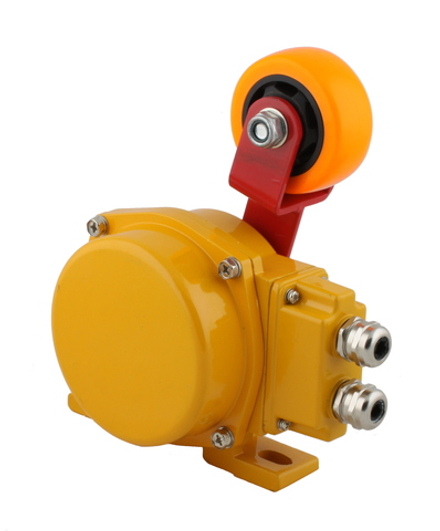

**За что отвечает.** Контроль чрезмерного провисания полотна между роликоопорами — признак перегруза, недостаточного натяжения, разрушенной/выпавшей роликоопоры или обрыва одной из ветвей. Провисшая лента цепляет металлоконструкции и рвётся.

**Как работает.** Под лентой на подпружиненном рычаге с роликом устанавливается датчик (обычно после точки загрузки). При нормальном положении лента рычага не касается. Провисшая лента давит на ролик, рычаг поворачивается и замыкает микропереключатель → предупреждение оператору или останов привода. Восстановление — автоматическое, при возврате ленты в нормальное положение. Выходной сигнал релейный, 1–2 контакта.

**Типовые модели.** ДПЛ-03(33), IL-BWS, IL-BWS-SS (нержавеющий корпус).

---

## 7. Датчик контроля повреждений и износа ленты (ДКПЛ)

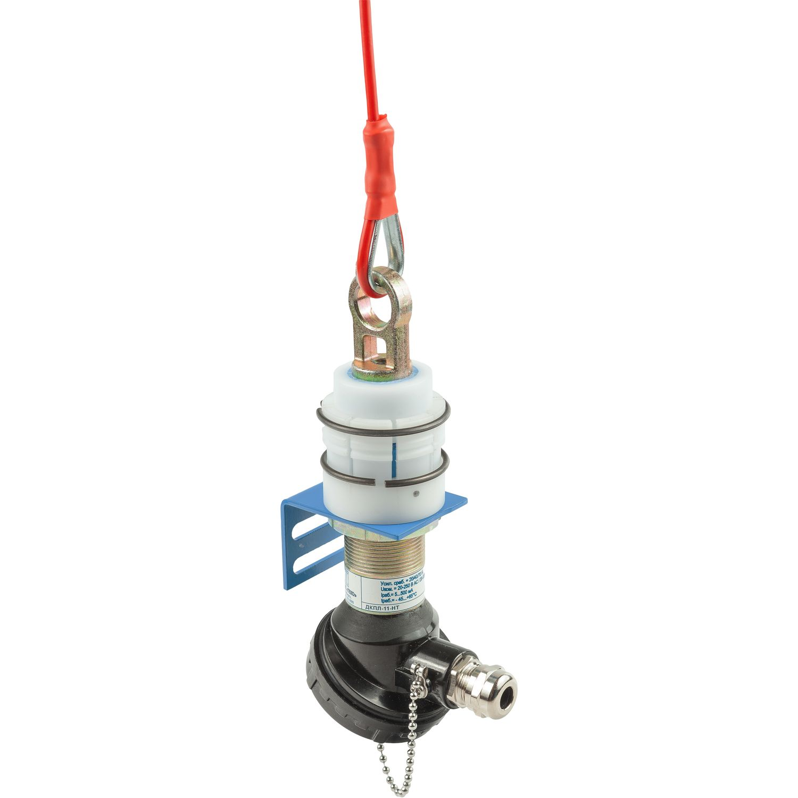

**За что отвечает.** Раннее выявление локальных повреждений полотна: задиров, порезов, отслоения обкладки, выступающих кусков стыковых элементов (механических замков), истончения рабочей обкладки. Позволяет остановить конвейер до превращения дефекта в продольный порыв.

**Как работает.** Поперёк ленты (над рабочей поверхностью и/или под холостой ветвью) устанавливается ряд подпружиненных щупов-лепестков / чувствительная планка, слегка касающаяся полотна. Проходящий дефект — вздутие, отставший кусок обкладки, торчащая скоба стыка — отклоняет щуп, и датчик формирует сигнал. В комбинации с датчиком скорости система «привязывает» дефект к координате по длине ленты, что даёт карту дефектов ленты для планового ремонта — это уже элемент предиктивной диагностики «Умного конвейера».

**Типовые модели.** ДКПЛ-11-…, ДКПЛ-…-НТ.

---

## 8. Датчик наличия перегруза / препятствия на ленте (IL-BHS, IL-BHS-M)

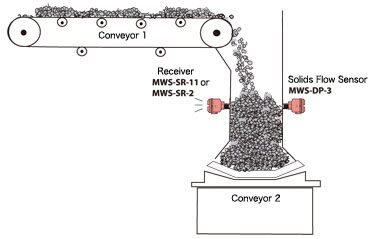
*(на фото — принцип флажкового/лопаточного контроля потока материала)*

**За что отвечает.** Контроль габарита слоя груза на ленте и наличие негабаритного куска или постороннего предмета, способного разрушить очиститель, скребок или заклинить в течке.

**Как работает.** Над лентой на раме подвешивается штанга с лопаткой (IL-BHS) или цепь с грузом (IL-BHS-M), висящая вертикально под собственным весом на заданной высоте над полотном. Слой груза выше нормы или крупный кусок отклоняет штангу/цепь, рычаг поворачивается и срабатывает микропереключатель → сигнал оператору или останов привода. Ставится по центру ленты, по ходу после точки загрузки/пересыпа. Восстановление автоматическое.

---

## 9. Датчики подпора, заштыбовки, забивки течки

**За что отвечает.** Защита узлов пересыпа и течек от завала: если нижележащий конвейер стоит или течка забилась, материал накапливается, забивает пересып и рвёт/забивает ленту.

**Как работает.** Применяются несколько принципов:
- **ротационные (лопастные) сигнализаторы уровня** — мотор вращает лопасть; при подходе материала лопасть стопорится, реагирует муфта и выдаётся сигнал;
- **микроволновые барьеры** (передатчик–приёмник по разные стороны течки) — перекрытие луча материалом = подпор;
- **вибрационные (камертонные)** и **ёмкостные** сигнализаторы уровня;
- **мембранные датчики подпора** — давление материала прогибает мембрану и замыкает контакт.

Сигнал блокирует загрузку и/или останавливает вышестоящий конвейер по цепочке (каскадная блокировка).

**Типовые модели.** Сигнализаторы уровня СУ-Е81(82), микроволновые ДС-2, ДС-3, ДС-3А, IL-MP-N, MWS-ST/SR.

---

## 10. Датчики температуры подшипников барабанов и редуктора

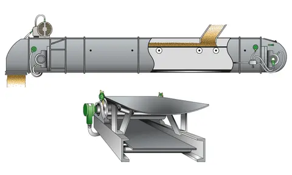

**За что отвечает.** Контроль перегрева подшипниковых узлов приводного и натяжного барабанов, а также редуктора и электродвигателя — предотвращение заклинивания, пожара (особенно на угольных конвейерах) и внепланового простоя.

**Как работает.** В корпус подшипника вворачивается контактный термодатчик (термопара / Pt100 / термостат с уставкой) либо к узлу подводится бесконтактный ИК-датчик. Двухпороговая логика: первый порог (например, +70 °С) — предупреждение и заявка на ТО, второй (например, +90…100 °С) — останов конвейера. В системе «Умный конвейер» данные пишутся в тренды и используются для предиктивного обслуживания вместе с датчиками вибрации подшипниковых узлов.

Дополнение — **датчики вибрации** приводной станции (диагностика износа подшипников, расцентровки муфты, дисбаланса барабана).

---

## 11. Контроль очистителей ленты и роликов

**За что отвечает.** Скребок-очиститель с трёхсторонним чистящим элементом (стандартная комплектация «Аконита») изнашивается; изношенный скребок перестаёт чистить (налипание на барабан → сход ленты), а сломавшийся — режет ленту.

**Как работает.** Датчик износа/положения контролирует ход прижимного механизма скребка: по мере износа полиуретановой ламели держатель поворачивается, и при достижении предельного положения индуктивный/концевой датчик выдаёт сигнал «требуется замена ножа». Дополнительно применяют датчики контроля давления прижима (пневмонатяжители) и **датчики вращения роликов** (RFID/индуктивные метки или акустический контроль) — невращающийся ролик протирается лентой и прожигает её.

---

## 12. Датчики контроля ограждений (ДОГ)

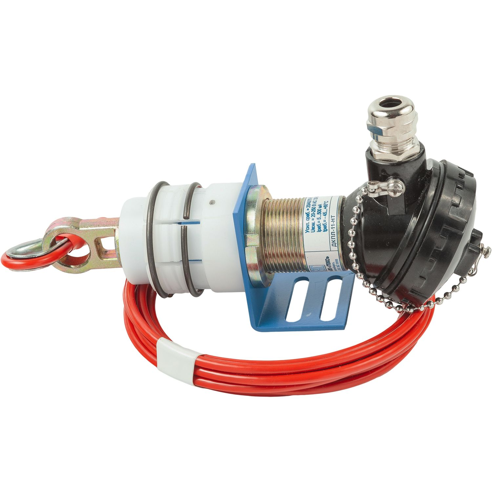

**За что отвечает.** Блокировка пуска и останов конвейера при снятии/открытии защитного ограждения привода, крышки люка, дверцы галереи, опускании шлагбаума — защита персонала от вращающихся частей.

**Как работает.** Герконовый бесконтактный датчик: неподвижная часть с герконом на раме, магнит — на подвижной створке. Когда ограждение закрыто, магнит удерживает геркон в замкнутом состоянии и цепь безопасности цела. Открытие ограждения выводит магнит из зоны чувствительности → контакт размыкается → останов. Бесконтактный принцип не боится грязи, пыли и обледенения.

**Типовые модели.** ДОГ-123-10(20)-…, ДОГ-123-10(20)-Ex.

---

## 13. Металлодетектор (металлоискатель над лентой)

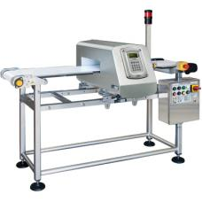

**За что отвечает.** Обнаружение случайных металлических предметов в потоке (зубья ковша экскаватора, куски футеровки, буровые коронки, крепёж) — они разбивают дробилки, мельницы и рвут ленту.

**Как работает.** Над лентой (или в виде рамки, охватывающей ленту) устанавливается катушка-индуктор, создающая переменное электромагнитное поле. Металл, попавший в поле, наводит вихревые токи и изменяет параметры контура — блок обработки фиксирует изменение и выдаёт сигнал: останов конвейера, либо срабатывание автоматического сбрасывателя/шибера для удаления куска в отбойный карман. Работает в связке с **железоотделителем (магнитным сепаратором)** над лентой.

---

## 14. Датчики уровня в бункерах и на загрузке

**За что отвечает.** Контроль наличия и уровня материала в приёмном бункере/течке: запрет пуска «на пустой» подачу, останов при переполнении, автоматика загрузки.

**Как работает.** Ёмкостные, вибрационные (камертон), ротационные, ультразвуковые и микроволновые уровнемеры: сигнализаторы «мин/макс» выдают дискретный сигнал по факту достижения уровня, непрерывные — аналоговый 4…20 мА в SCADA для расчёта запаса материала.

**Типовые модели.** СУ-Е81(82), IL-MP-N, MWS-ST/SR-2-24C.

---

## 15. Датчик обратного хода (антиреверс) и контроль тормоза

**За что отвечает.** На наклонных конвейерах при отключении питания под нагрузкой лента может поехать назад — это разрушает привод и заваливает узел загрузки. Также контролируется работа остановочного тормоза и обгонной муфты.

**Как работает.** Двухканальный датчик скорости (два индуктивных датчика со сдвигом фаз) определяет не только скорость, но и **направление** вращения барабана; при появлении импульсов в обратной последовательности выдаётся аварийный сигнал и включается тормоз/храповый останов. Отдельные концевые датчики контролируют разжатие/зажатие колодок тормоза.

---

## 16. Датчики натяжения ленты (тензодатчики натяжной станции)

**За что отвечает.** Контроль фактического усилия натяжения: недостаток → пробуксовка и провисание, избыток → перегрузка стыка и подшипников. Для лебёдочных (автоматических) натяжных станций — обратная связь регулирования.

**Как работает.** Тензометрический датчик встраивается между рамой и натяжным устройством (или в ось барабана). Деформация упругого элемента меняет сопротивление тензорезисторов моста → аналоговый сигнал усилия в контроллер, который поддерживает натяжение по программе (повышенное на пуске, номинальное в работе).

---

## 17. Конвейерные весы

**За что отвечает.** Измерение погонной нагрузки и производительности (т/ч, накопительно т), учёт отгрузки — базовая метрика для «Умного конвейера».

**Как работает.** Взвешивающая роликоопора на тензодатчиках даёт вес материала на участке; датчик скорости ленты даёт м/с; контроллер перемножает и интегрирует по времени. Одновременно служит защитой от перегруза ленты и двигателя.

---

## Как это собирается в систему на конвейере «Аконита»

1. **Полевой уровень** — перечисленные датчики: цепь безопасности (ДЭК + ДКСЛ 30° + УКПР + ДКПГ) заводится в шлейф, размыкание которого мгновенно снимает питание с привода без участия ПЛК.
2. **Уровень блоков контроля** — УКК «Адрес», УКС/УКМС, УКПР, КСК-31Р: они питают/опрашивают датчики, дают выдержки времени, определяют **адрес сработавшего датчика** (критично на трассе в километры).
3. **ПЛК/АСУ ТП** — блокировки каскада конвейеров, последовательность пуска «с конца линии», предпусковая звуковая сигнализация.
4. **SCADA / онлайн-диагностика 24/7** — тренды температуры, вибрации, скорости, наработки; карта дефектов ленты; предиктивные заявки на ТО и консигнационный склад запчастей.

---

## Что уточнить у «Аконита» под конкретный проект

- Категория объекта: обычное (РН) или **взрывозащищённое (Ex)** исполнение — для угля/шахт нужны серии …-Ex.
- Температурное исполнение датчиков: под заявленные −60 °С нужны версии **2НТ**.
- Нужен ли **адресный** контроль (модули АМ + УКК «Адрес») — для длинных трасс.
- Требуется ли контроль целостности ленты кордовыми магнитными петлями (дороже, но выявляет порыв мгновенно и по всей длине).
- Комплектация конвейерными весами и системой видеоаналитики узлов пересыпа.

**Контакты для официального перечня по вашей спецификации:** +7 (8172) 20-90-16, conveyor@npoakonit.ru, [опросный лист](https://www.npoakonit.ru/sites/default/files/product/2021/oprosnyy_list_1_ctranica.docx).
